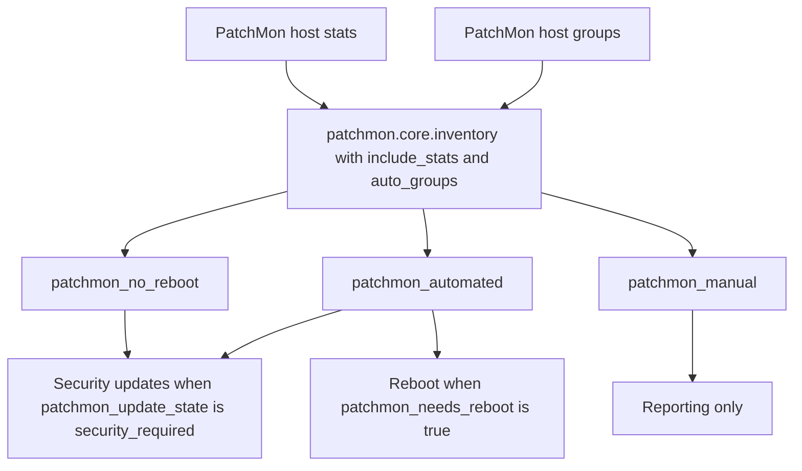
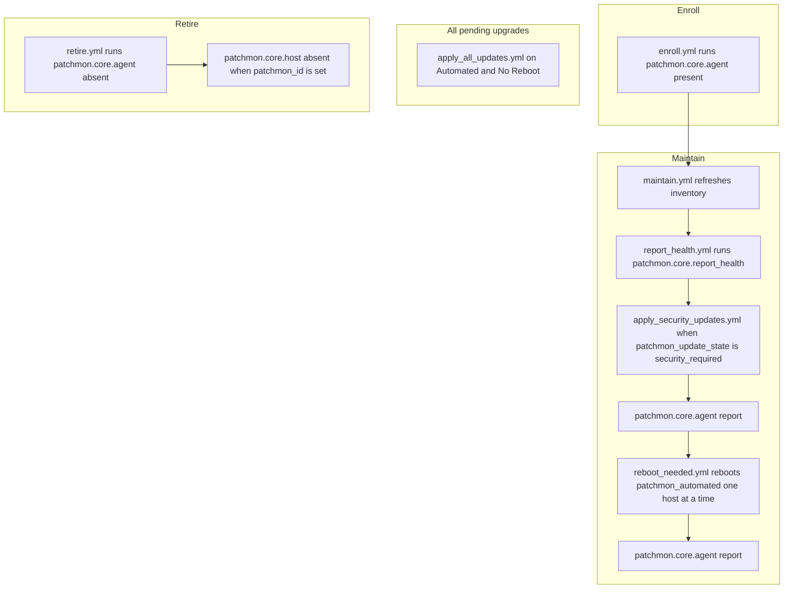

# Ansible Collection - patchmon.core

Dynamic inventory, modules, lookups, and roles for the [PatchMon](https://patchmon.net) Integration and Auto-Enrollment APIs.

## Description

The `inventory` plugin turns PatchMon hosts and host groups into a live Ansible inventory. With `include_stats: true` it also exposes reboot, update, security, OS, and reporting metadata as host variables and optional auto groups — so you can target fleets with `--limit patchmon_security_required` or Constructable expressions.

Companion content:

| Type | FQCN | Purpose |
|------|------|---------|
| Inventory | `patchmon.core.inventory` | List hosts / groups / stats hostvars |
| Module | `patchmon.core.host_info` | Aggregate `/info`, `/stats`, `/notes`, `/package_reports`, `/agent_queue`, … |
| Module | `patchmon.core.host_packages` | List packages (optionally updates only) |
| Module | `patchmon.core.host` | Enroll or delete a host entry |
| Module | `patchmon.core.host_token` | Enrollment script / admin token CRUD |
| Lookup | `patchmon.core.host` | Ad-hoc per-host API lookups |
| Role | `patchmon.core.agent` | Install / start / stop / report / remove agent |
| Role | `patchmon.core.host` | Create or delete host entries |
| Role | `patchmon.core.report_health` | Fail unless the newest package report succeeded |

**Permissions matter.** Read plugins need Integration `host:get`. Creating hosts and installing agents need **Auto-Enrollment** credentials — not Integration Basic Auth. See **[docs/permissions.md](docs/permissions.md)**.

**Upgrading from 1.0.0** (`patchmon.dynamic_inventory`): this is a breaking change — install `patchmon.core` and update `plugin:` to `patchmon.core.inventory`. Step-by-step: **[docs/migrating_to_2.0.md](docs/migrating_to_2.0.md)**.

## Requirements

- **Ansible**: >= 2.15.0
- **Python**: 3.9+
- **Dependencies**: `requests >= 2.25.1`

## Installation

### Ansible Galaxy

```bash
ansible-galaxy collection install patchmon.core
```

### Offline / air-gapped (GitHub Release tarball)

Tagged releases publish `patchmon-core-<version>.tar.gz` as a release asset:

1. Download the tarball from the [Releases](https://github.com/PatchMon/PatchMon-ansible/releases) page (or your fork’s Releases).
2. Copy it to the target system.
3. Install:

```bash
ansible-galaxy collection install ./patchmon-core-2.0.1.tar.gz
pip install 'requests>=2.25.1'
```

Or install directly from a release URL when the controller can reach GitHub:

```bash
ansible-galaxy collection install \
  https://github.com/PatchMon/PatchMon-ansible/releases/download/v2.0.1/patchmon-core-2.0.1.tar.gz
```

### From source

```bash
git clone https://github.com/PatchMon/PatchMon-ansible.git
cd PatchMon-ansible
ansible-galaxy collection build
ansible-galaxy collection install patchmon-core-*.tar.gz
pip install -r requirements.txt
```

## Using the examples

Full walkthrough (inventory + playbooks, troubleshooting): **[examples/README.md](examples/README.md)**.

| Example | Purpose |
|---------|---------|
| [`examples/patchmon_inventory.yml`](examples/patchmon_inventory.yml) | Minimal / backward-compatible inventory |
| [`examples/patchmon_inventory_stats.yml`](examples/patchmon_inventory_stats.yml) | Stats inventory + optional Constructable |
| [`examples/playbooks/host_info.yml`](examples/playbooks/host_info.yml) | `host_info` over inventory hosts |
| [`examples/playbooks/pending_updates.yml`](examples/playbooks/pending_updates.yml) | `host_packages` (pending / security) |
| [`examples/playbooks/host_info_by_id.yml`](examples/playbooks/host_info_by_id.yml) | Modules by UUID (no dynamic inventory) |
| [`examples/playbooks/lookup_system.yml`](examples/playbooks/lookup_system.yml) | `host` lookup |

Quick path:

```bash
# After installing the collection and enabling the plugin (see examples/README.md)
cp examples/patchmon_inventory_stats.yml inventories/patchmon.yml
# Edit api_url; then:
export PATCHMON_API_URL='https://patchmon.example.com/api/v1/api/hosts'
export PATCHMON_API_KEY='...'
export PATCHMON_API_SECRET='...'
ansible-inventory -i inventories/patchmon.yml --graph
ansible-playbook -i inventories/patchmon.yml examples/playbooks/pending_updates.yml \
  --limit patchmon_security_required
```

## Example fleet pattern

These diagrams show a fleet built from the inventory plugin and the roles. The plays are in [`examples/playbooks/`](examples/playbooks/). **Automated**, **No Reboot**, and **Manual** are example PatchMon group names. The plugin maps each group to an Ansible group `patchmon_<slug>`.

### Who is eligible for what



Start from [`examples/patchmon_inventory_stats.yml`](examples/patchmon_inventory_stats.yml). `patchmon_update_state` and `patchmon_needs_reboot` are inventory hostvars, so a play can gate on them before fact gathering. Stats auto-groups such as `patchmon_security_required` appear only while a host matches. Keep those names out of `hosts:` and use the hostvars for the gate. The hostvar table and the auto-group table are under [Inventory configuration](#inventory-configuration).

### Enroll, maintain, and retire



| Playbook | When it runs |
|----------|----------------|
| [`examples/playbooks/enroll.yml`](examples/playbooks/enroll.yml) | A host joins. Installs the agent. The host stays in the Auto-Enrollment token's default group. |
| [`examples/playbooks/maintain.yml`](examples/playbooks/maintain.yml) | Recurring job. Refreshes inventory, checks report health, applies security-only updates, then reboots Automated one host at a time. |
| [`examples/playbooks/apply_all_updates.yml`](examples/playbooks/apply_all_updates.yml) | Separate from maintain. All pending packages on Automated and No Reboot. |
| [`examples/playbooks/retire.yml`](examples/playbooks/retire.yml) | A host leaves. Removes the agent, then deletes the host record when `patchmon_id` is set. Requires `--limit`. |

`maintain.yml` imports [`report_health.yml`](examples/playbooks/report_health.yml), [`apply_security_updates.yml`](examples/playbooks/apply_security_updates.yml), and [`reboot_needed.yml`](examples/playbooks/reboot_needed.yml). Run them against a stats inventory (`include_stats: true`). Pass `--limit` when you want a subset.

Enroll runs when a host joins. The new host stays in the enrollment token's default group. There is no Integration route to set a policy group from a play. Maintain is the recurring job. `patchmon.core.report_health` fails that host when the newest package report is missing or the status is not success, and other hosts continue. `dnf` and `dnf5` can take a security-only upgrade. `apt` has no matching flag, so the opt-in path lists packages with `patchmon.core.host_packages` (`updates_only: true`) and upgrades names where `is_security_update` is true (`-e patchmon_try_listed_security=true`). After those updates, and again after a reboot, run `patchmon.core.agent` with `agent_state: report`.

All pending upgrades (`apt` safe, `dnf` latest) are a separate play for Automated and No Reboot. Reboot stays on the maintain path. Retire removes the agent, then deletes the host record. An empty `patchmon_id` skips that delete, so a host that never enrolled can still be removed. Pass `--limit` to `retire.yml`.

Inventory, report health, and package reads use an Integration token with `host:get`. Installing the agent and creating the host use Auto-Enrollment. See **[docs/permissions.md](docs/permissions.md)**.

## Inventory configuration

Create an inventory file, or copy an example from [`examples/`](examples/) and edit `api_url`:

```yaml
---
plugin: patchmon.core.inventory
api_url: https://patchmon.example.com/api/v1/api/hosts
api_key: "{{ lookup('env', 'PATCHMON_API_KEY') }}"
api_secret: "{{ lookup('env', 'PATCHMON_API_SECRET') }}"
verify_ssl: true
```

Canonical API URL: `https://<patchmon-host>/api/v1/api/hosts`  
(`api_url` may also be the instance root; the plugin appends `/api/v1/api/hosts`.)

### Configuration options

| Option | Required | Default | Description |
|--------|----------|---------|-------------|
| `plugin` | yes | — | Must be `patchmon.core.inventory` |
| `api_url` | yes | — | Hosts endpoint or instance root (`PATCHMON_API_URL`) |
| `api_key` | yes | — | Token Key (`PATCHMON_API_KEY`) |
| `api_secret` | yes | — | Token Secret (`PATCHMON_API_SECRET`) |
| `verify_ssl` | no | `true` | TLS verify (`PATCHMON_VERIFY_SSL`) |
| `timeout` | no | `30` | HTTP timeout (seconds) |
| `include_stats` | no | `false` | Request `?include=stats` and set `patchmon_*` hostvars |
| `stats_var_scope` | no | `all` | `all` exports every stats hostvar. `targeting` keeps group and play-gate fields and omits telemetry |
| `hostgroup` | no | — | Filter by group id or the exact PatchMon name. A `patchmon_<slug>` token is not translated |
| `auto_groups` | no | `true` | Derived groups when `include_stats` is true |
| `inventory_hostname_prefer` | no | `hostname` | `hostname` or `friendly_name` |
| `compose` / `groups` / `keyed_groups` | no | — | Ansible constructed inventory features |
| `cache` | no | `false` | Enable inventory caching |

### Data-rich inventory (`include_stats`)

```yaml
---
plugin: patchmon.core.inventory
api_url: https://patchmon.example.com/api/v1/api/hosts
include_stats: true
compose:
  patchmon_has_security_updates: patchmon_security_updates_count | int > 0
keyed_groups:
  - key: patchmon_update_state
    prefix: patchmon_update_state
groups:
  patchmon_reboot_and_security: patchmon_needs_reboot and patchmon_security_updates_count | int > 0
```

#### Host variables (with `include_stats`)

Identity and group membership are always inventory variables. Stats fields used to build groups or to gate a play before fact gathering stay inventory variables too. Telemetry that does not select hosts is omitted when `stats_var_scope: targeting`.

| Hostvar | Scope | Source |
|---------|-------|--------|
| `ansible_host` / `patchmon_ip` | always | `ip` |
| `patchmon_id` | always | `id` |
| `patchmon_hostname` / `patchmon_friendly_name` | always | identity fields |
| `patchmon_groups` | always | list of `{id, name, ansible_group}` for each PatchMon host group. `name` is the PatchMon value and may contain spaces |
| `patchmon_os_type` | `all` and `targeting` | OS family; also builds `patchmon_os_<os>` |
| `patchmon_effective_status` / `patchmon_reporting_state` | `all` and `targeting` | `patchmon_inactive`, `patchmon_stale`, `patchmon_overdue` |
| `patchmon_update_state` | `all` and `targeting` | `up_to_date`, `updates_pending`, `security_required` |
| `patchmon_needs_reboot` | `all` and `targeting` | boolean; also builds `patchmon_needs_reboot` |
| `patchmon_security_updates_count` | `all` and `targeting` | play conditions |
| `patchmon_os_version` | `all` only | OS version |
| `patchmon_status` | `all` only | raw status |
| `patchmon_updates_count` / `patchmon_total_packages` | `all` only | package counts |
| `patchmon_last_update` | `all` only | last agent report |

`stats_var_scope` defaults to `all`, which matches earlier 2.0 inventories. `targeting` still creates auto groups from the API payload. `compose`, `groups`, and `keyed_groups` expressions that read an omitted hostvar need `all`.

Do not copy the same names into facts. A flat fact named `patchmon_needs_reboot` would override the inventory variable after fact gathering, and the two caches would drift. The inventory plugin does not set `ansible_facts`.

Unprefixed compose aliases `ip`, `hostname`, and `friendly_name` are also set for Constructable expressions. Prefer `patchmon_*` names in playbooks to avoid collisions with user variables. They are not copied into facts.

#### Host facts (`host_info` `inject_facts`)

`patchmon.core.host_info` with `inject_facts: true` returns `ansible_facts.patchmon`. Keys are unprefixed (`needs_reboot`, `updates_count`, `os_version`, `status`, plus `id`, `hostname`, `friendly_name`, and `ip`). That dict is the place for telemetry, including the fields `targeting` leaves off the inventory host. `delegate_to: localhost`. Default `inject_facts` is `false`, so a `register:` of `host` is unchanged.


#### Auto groups (when `include_stats` and `auto_groups`)

| Group | Condition |
|-------|-----------|
| `patchmon_needs_reboot` | `needs_reboot` |
| `patchmon_security_required` | `update_state == security_required` |
| `patchmon_updates_pending` | `update_state == updates_pending` |
| `patchmon_up_to_date` | `update_state == up_to_date` |
| `patchmon_stale` / `patchmon_overdue` | `reporting_state` |
| `patchmon_inactive` | `effective_status == inactive` |
| `patchmon_os_<os>` | sanitized `os_type` |

#### Host groups

Every PatchMon `host_groups[]` entry becomes an Ansible group under the same `patchmon_` prefix:

| PatchMon name | Ansible group |
|---------------|---------------|
| `Automated` | `patchmon_automated` |
| `No Reboot` | `patchmon_no_reboot` |
| `No_Reboot` (and `No Reboot` also exists) | `patchmon_no_reboot_<group_id>` |

Spaces, hyphens, and other characters Ansible rejects are replaced with `_`, then lowercased. The original name is group var `patchmon_group_name` and the UUID is `patchmon_group_id`. When two groups share a slug, both names append the sanitized group id so a space is not silently treated as an underscore. A slug that matches a stats auto-group (`patchmon_needs_reboot`, `patchmon_os_<type>`, and the others above) is suffixed the same way.

`hostgroup` accepts a group id or the exact PatchMon name. `No Reboot` and `No_Reboot` stay different groups. An Ansible `patchmon_<slug>` token is not translated, because the Integration API has no group catalog.

```bash
ansible-playbook site.yml -i patchmon_inventory.yml --limit patchmon_security_required
ansible-playbook reboot.yml -i patchmon_inventory.yml --limit patchmon_needs_reboot
```

## Usage

```bash
# List inventory
ansible-inventory -i patchmon_inventory.yml --list

# Enable the plugin globally
# ansible.cfg:
# [inventory]
# enable_plugins = patchmon.core.inventory
```

### Modules

Call PatchMon from the control node (`delegate_to: localhost`). Prefer a stats inventory so `patchmon_id` is set, or pass the UUID with `-e patchmon_id=...`.

| Module | Purpose | Access |
|--------|---------|--------|
| `patchmon.core.host_info` | Aggregate host detail endpoints via `gather_subset`. `inject_facts: true` sets `ansible_facts.patchmon` | Integration `host:get` |
| `patchmon.core.host_packages` | List packages; `updates_only: true` for pending updates | Integration `host:get` |
| `patchmon.core.host` | Enroll (`state=present`) or delete (`state=absent`) | Auto-Enrollment / `host:delete` |
| `patchmon.core.host_token` | Fetch install script or manage enrollment tokens | Auto-Enrollment / admin JWT |

```yaml
- name: Gather PatchMon host details
  patchmon.core.host_info:
    api_url: "{{ lookup('env', 'PATCHMON_API_URL') }}"
    api_key: "{{ lookup('env', 'PATCHMON_API_KEY') }}"
    api_secret: "{{ lookup('env', 'PATCHMON_API_SECRET') }}"
    host_id: "{{ patchmon_id }}"
    gather_subset: [info, stats, system]
  delegate_to: localhost
  register: pm_info

- name: Read telemetry as nested facts (does not override patchmon_* hostvars)
  patchmon.core.host_info:
    api_url: "{{ lookup('env', 'PATCHMON_API_URL') }}"
    api_key: "{{ lookup('env', 'PATCHMON_API_KEY') }}"
    api_secret: "{{ lookup('env', 'PATCHMON_API_SECRET') }}"
    host_id: "{{ patchmon_id }}"
    gather_subset: [info, stats, system]
    inject_facts: true
  delegate_to: localhost

- name: List packages with updates
  patchmon.core.host_packages:
    api_url: "{{ lookup('env', 'PATCHMON_API_URL') }}"
    api_key: "{{ lookup('env', 'PATCHMON_API_KEY') }}"
    api_secret: "{{ lookup('env', 'PATCHMON_API_SECRET') }}"
    host_id: "{{ patchmon_id }}"
    updates_only: true
  delegate_to: localhost
  register: pm_pkgs

- name: Show security updates
  ansible.builtin.debug:
    msg: "{{ item.name }}: {{ item.current_version }} -> {{ item.available_version }}"
  loop: "{{ pm_pkgs.packages | selectattr('is_security_update') | list }}"
  loop_control:
    label: "{{ item.name }}"
```

Runnable copies: [`examples/playbooks/`](examples/playbooks/).

### Roles and playbooks

| Role | Thin playbook | Purpose |
|------|---------------|---------|
| `patchmon.core.agent` | [`playbooks/agent.yml`](playbooks/agent.yml) | Install/start/stop/report/remove agent |
| `patchmon.core.host` | [`playbooks/host.yml`](playbooks/host.yml) | Enroll or delete host entries |

See each role’s README for variables and required credentials.

### Lookup

```yaml
- name: Fetch system details
  ansible.builtin.set_fact:
    patchmon_system: "{{ lookup('patchmon.core.host', patchmon_id, resource='system') }}"
```

`resource` may be `info`, `stats`, `system`, `network`, `integrations`, `packages`, or `notes`. For packages with updates only, pass `updates_only=true`. See [`examples/playbooks/lookup_system.yml`](examples/playbooks/lookup_system.yml).

## Authentication and permissions

**Read-only** (inventory, info, packages, lookup): Integration API HTTP Basic Auth with at least `host:get`. Create under **Settings → Integrations → API**.

**Provisioning** (create hosts, install agent): Auto-Enrollment key/secret under **Settings → Integrations → Auto-Enrollment**. There is no Integration `host:create` scope.

**Delete hosts**: Integration scope `host:delete`.

Full matrix and least-privilege guidance: **[docs/permissions.md](docs/permissions.md)**.

Prefer environment variables, Ansible Vault, or AAP credentials over plaintext secrets:

```bash
export PATCHMON_API_URL=https://patchmon.example.com/api/v1/api/hosts
export PATCHMON_API_KEY=...
export PATCHMON_API_SECRET=...
# Provisioning (separate from read-only tokens when possible):
export PATCHMON_SERVER_URL=https://patchmon.example.com
export PATCHMON_ENROLLMENT_KEY=...
export PATCHMON_ENROLLMENT_SECRET=...
```

## Compliance note

Host compliance status is **not** currently exposed on the scoped Integration API (`/api/v1/api/...`). Compliance routes live under `/api/v1/compliance/*` with session RBAC. This collection does not scrape session cookies. Tracking request: [Expose compliance summary on the Integration API](https://feedback.patchmon.net/b/feature-requests/posts/post_01m5aw69zbe04r3hm0efeedbxj). Once those fields land, a follow-up release will map `patchmon_compliance_*` hostvars and groups.

## Host changes the Integration API does not expose

Changing a host's friendly name, notes, auto-update flag, host-down alerts, or group membership requires a signed-in user (`PATCH` and `PUT` under `/api/v1/hosts/...`). The same is true of fetch-report, force-agent-update, and regenerate-credentials. This collection does not call those routes and does not use session cookies. Inventory still maps `host_groups` from `GET /api/v1/api/hosts`. Reading notes stays on `host_info`. Group writes are tracked by [PatchMon issue 595](https://github.com/PatchMon/PatchMon/issues/595). Paste-ready requests: [PATCHMON-FEEDBACK.md](PATCHMON-FEEDBACK.md).

## Feedback this collection addresses

PatchMon feature requests live on the [feedback portal](https://feedback.patchmon.net/). [How the portal works](https://feedback.patchmon.net/hc/en/articles/9-how-the-feedback-portal-works) explains where bugs, questions, and ideas each go, and how to upvote.

Please upvote [Adopt patchmon.core 2.0 as the official Ansible collection](https://feedback.patchmon.net/b/feature-requests/posts/post_01m5fj33qte04r3x9v6527stma). That post asks PatchMon to adopt this collection as the official Ansible collection. The write-up is [PROPOSAL.md](PROPOSAL.md). Limits this collection does not paper over are in [PATCHMON-FEEDBACK.md](PATCHMON-FEEDBACK.md).

| Request | What this collection provides |
|---------|-------------------------------|
| [Ansible Dynamic Inventory](https://feedback.patchmon.net/b/feature-requests/posts/post_01kyzbkqs5fzst21twgbqvnze2) | `patchmon.core.inventory` lists hosts, groups, and stats hostvars |
| [Automatic rollout of agents via API with Ansible](https://feedback.patchmon.net/b/feature-requests/posts/post_01kyze5xncfzst242c0107agdf) | `patchmon.core.agent` enrolls a host and installs, starts, stops, reports, or removes the agent |
| [Patch Management using Ansible](https://feedback.patchmon.net/b/feature-requests/posts/post_01kyz5ctqsenfvfjamcjdyxmqf) | Inventory groups and hostvars such as `patchmon_update_state` and `patchmon_needs_reboot`, so plays can patch and reboot selected hosts |

## Development

```bash
pip install -r requirements.txt pytest ansible-lint
pytest
ansible-lint examples/playbooks playbooks
```

Pull requests run the [CI](.github/workflows/ci.yml) workflow (pytest + ansible-lint).

### Cutting a release

1. Bump `galaxy.yml` `version`, update `CHANGELOG.md`, and merge to `main`.
2. Tag the release commit (tag must match `galaxy.yml`, with a `v` prefix):

```bash
git tag -a v2.0.1 -m "patchmon.core 2.0.1"
git push origin v2.0.1
```

3. The [Release collection](.github/workflows/release.yml) workflow runs tests, builds the collection tarball, and creates a GitHub Release with the `.tar.gz` attached for offline installs.

You can also run the workflow manually (**Actions → Release collection → Run workflow**) and supply an existing tag such as `v2.0.1`.

## License

AGPL-3.0-or-later — see [LICENSE](LICENSE).

## Authors

- Steve Libonati <stevelibonati@yahoo.com>
- Contributors welcome via [GitHub Issues](https://github.com/PatchMon/PatchMon-ansible/issues)

## Links

- [Module documentation](https://mrjoshuap.github.io/PatchMon-ansible/)
- [Upvote: adopt patchmon.core 2.0](https://feedback.patchmon.net/b/feature-requests/posts/post_01m5fj33qte04r3x9v6527stma)
- [Proposal to adopt patchmon.core 2.0](PROPOSAL.md)
- [Permissions](docs/permissions.md)
- [Migrate from 1.x](docs/migrating_to_2.0.md)
- [Examples guide](examples/README.md)
- [Changelog](CHANGELOG.md)
- [This fork](https://github.com/mrjoshuap/PatchMon-ansible)
- [Upstream collection](https://github.com/PatchMon/PatchMon-ansible)
- [PatchMon](https://patchmon.net)
- [PatchMon source](https://github.com/PatchMon/PatchMon)
- [PatchMon docs](https://patchmon.net/docs)
- [PatchMon Integration API docs](https://patchmon.net/docs/patchmon-api-integrations-guide/integration-api-documentation)
- [Auto-Enrollment API docs](https://patchmon.net/docs/patchmon-api-integrations-guide/auto-enrolment-api-docs)
- [Feedback portal](https://feedback.patchmon.net/)
- [How the feedback portal works](https://feedback.patchmon.net/hc/en/articles/9-how-the-feedback-portal-works)
- [Report a PatchMon bug](https://github.com/PatchMon/PatchMon/issues)
- [Ask a PatchMon question](https://github.com/PatchMon/PatchMon/discussions)
- [Discord](https://patchmon.net/discord)
