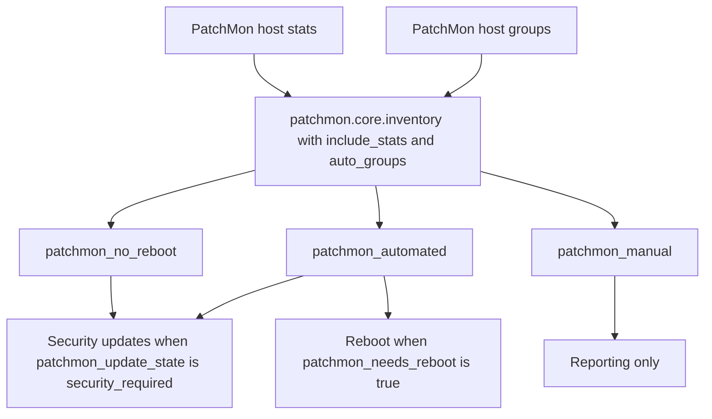
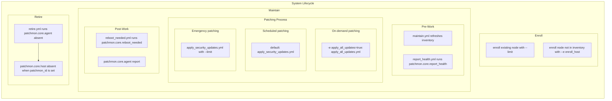

# Automator guide

This book is for people who write inventories and playbooks around PatchMon. It is the source of truth for collection behavior. Option tables and return values stay on the generated plugin and role pages. Copy-paste plays stay in [`examples/playbooks/`](../examples/playbooks/).

Product behavior stays in the upstream PatchMon books:

- [Admin guide](https://patchmon.net/docs/patchmon-admin-guide) for the web UI, host groups, patch policies, compliance, and users.
- [Operator guide](https://patchmon.net/docs/patchmon-operator-guide) for server install, the agent, and `config.yml`.
- [API and integrations guide](https://patchmon.net/docs/patchmon-api-integrations-guide) for HTTP endpoints. Chapter 3 of that book documents the 1.0 inventory plugin (`patchmon.dynamic_inventory`) only. This guide covers `patchmon.core`.

People changing this repository should read the [developer guide](developer-guide.md).

## Table of Contents

- [Chapter 1: What this collection automates](#chapter-1-what-this-collection-automates)
- [Chapter 2: Install](#chapter-2-install)
- [Chapter 3: Credentials](#chapter-3-credentials)
- [Chapter 4: First inventory](#chapter-4-first-inventory)
- [Chapter 5: Hostvars, groups, and limits](#chapter-5-hostvars-groups-and-limits)
- [Chapter 6: Fleet lifecycle](#chapter-6-fleet-lifecycle)
- [Chapter 7: Read and lookup playbooks](#chapter-7-read-and-lookup-playbooks)
- [Chapter 8: Troubleshooting](#chapter-8-troubleshooting)
- [Chapter 9: Migrating from 1.0](#chapter-9-migrating-from-1-0)
- [Chapter 10: Limits](#chapter-10-limits)

## Chapter 1: What this collection automates

`patchmon.core` turns PatchMon hosts into an Ansible inventory and gives plays a way to enroll hosts, install the agent, read host detail, and run a patch cycle.

| Type | FQCN | Purpose |
|------|------|---------|
| Inventory | [`patchmon.core.inventory`](https://mrjoshuap.github.io/PatchMon-ansible/inventory_inventory.html) | List hosts, groups, and stats hostvars |
| Module | [`patchmon.core.host_info`](https://mrjoshuap.github.io/PatchMon-ansible/host_info_module.html) | Aggregate `/info`, `/stats`, `/notes`, `/package_reports`, `/agent_queue`, and related routes |
| Module | [`patchmon.core.host_packages`](https://mrjoshuap.github.io/PatchMon-ansible/host_packages_module.html) | List packages, optionally updates only |
| Module | [`patchmon.core.host`](https://mrjoshuap.github.io/PatchMon-ansible/host_module.html) | Enroll or delete a host entry |
| Module | [`patchmon.core.host_token`](https://mrjoshuap.github.io/PatchMon-ansible/host_token_module.html) | Enrollment script and admin token CRUD |
| Lookup | [`patchmon.core.host`](https://mrjoshuap.github.io/PatchMon-ansible/host_lookup.html) | Ad-hoc per-host API lookups |
| Lookup | [`patchmon.core.endpoint`](https://mrjoshuap.github.io/PatchMon-ansible/endpoint_lookup.html) | Derive the hosts and auto-enrollment URLs |
| Role | [`patchmon.core.agent`](https://mrjoshuap.github.io/PatchMon-ansible/agent_role.html) | Install, start, stop, report, or remove the agent |
| Role | [`patchmon.core.host`](https://mrjoshuap.github.io/PatchMon-ansible/host_role.html) | Create or delete host entries |
| Role | [`patchmon.core.report_health`](https://mrjoshuap.github.io/PatchMon-ansible/report_health_role.html) | Fail unless the newest package report succeeded |
| Role | [`patchmon.core.apply_security_updates`](https://mrjoshuap.github.io/PatchMon-ansible/apply_security_updates_role.html) | Security-only package updates, then a local agent report |
| Role | [`patchmon.core.apply_all_updates`](https://mrjoshuap.github.io/PatchMon-ansible/apply_all_updates_role.html) | All pending package upgrades, then a local agent report |
| Role | [`patchmon.core.reboot_needed`](https://mrjoshuap.github.io/PatchMon-ansible/reboot_needed_role.html) | Reboot when `patchmon_needs_reboot` is true, then a local agent report |

With `include_stats: true`, the inventory exposes reboot, update, security, OS, and reporting metadata as host variables and optional auto groups. A play can target a fleet with `--limit patchmon_security_required` or with Constructable expressions.

Read plugins need an Integration token with `host:get`. Creating hosts and installing agents need Auto-Enrollment credentials. [Chapter 3](#chapter-3-credentials) is the full matrix.

## Chapter 2: Install

Requirements:

- Ansible >= 2.15.0
- Python 3.9+
- `requests` >= 2.25.1 on the control node

### Ansible Galaxy

```bash
ansible-galaxy collection install patchmon.core
pip install 'requests>=2.25.1'
```

### Offline / air-gapped

Tagged releases publish `patchmon-core-<version>.tar.gz` as a release asset.

1. Download the tarball from the [Releases](https://github.com/PatchMon/PatchMon-ansible/releases) page (or your fork's Releases).
2. Copy it to the target system.
3. Install:

```bash
ansible-galaxy collection install ./patchmon-core-2.0.6.tar.gz
pip install 'requests>=2.25.1'
```

When the controller can reach GitHub:

```bash
ansible-galaxy collection install \
  https://github.com/PatchMon/PatchMon-ansible/releases/download/v2.0.6/patchmon-core-2.0.6.tar.gz
```

### From source

```bash
git clone https://github.com/PatchMon/PatchMon-ansible.git
cd PatchMon-ansible
ansible-galaxy collection build
ansible-galaxy collection install patchmon-core-*.tar.gz
pip install -r requirements.txt
```

### Enable the inventory plugin

Once per project, in `ansible.cfg`:

```ini
[inventory]
enable_plugins = patchmon.core.inventory
```

## Chapter 3: Credentials

PatchMon uses different credential types for different operations. Using the wrong type produces HTTP 401 or 403. The token can be valid and still be the wrong kind of token.

Create tokens in the PatchMon UI. The [admin guide](https://patchmon.net/docs/patchmon-admin-guide) covers Settings. HTTP details are in the [Integration API](https://patchmon.net/docs/patchmon-api-integrations-guide/integration-api-documentation) and [Auto-Enrollment API](https://patchmon.net/docs/patchmon-api-integrations-guide/auto-enrolment-api-docs) chapters. This chapter maps those credentials onto this collection.

Prefer environment variables, Ansible Vault, or Automation Controller credentials. Set `PATCHMON_SERVER_URL` to the instance root and leave `PATCHMON_ENROLLMENT_URL` and `PATCHMON_API_URL` unset. The collection derives `https://patchmon.example.com/api/v1/auto-enrollment` and `https://patchmon.example.com/api/v1/api/hosts`. Setting either derived variable overrides that URL and is discouraged.

```bash
export PATCHMON_SERVER_URL=https://patchmon.example.com
export PATCHMON_API_KEY=...
export PATCHMON_API_SECRET=...
# Provisioning, separate from read-only tokens when possible:
export PATCHMON_ENROLLMENT_KEY=...
export PATCHMON_ENROLLMENT_SECRET=...
# Optional TLS. true is the default. false is for a lab only.
# export PATCHMON_VERIFY_SSL=true
```

The inventory file is not templated. `lookup()` and other Jinja in `api_url`, `api_key`, or `api_secret` are sent to PatchMon as literal text. `compose`, `groups`, and `keyed_groups` are expressions the plugin evaluates.

### Credential types

| Type | Auth | Where created | Used for |
|------|------|---------------|----------|
| Integration API | HTTP Basic (`api_key`:`api_secret`) | Settings → Integrations → API | Inventory, `host_info`, `host_packages`, lookup, host delete |
| Auto-Enrollment | `X-Auto-Enrollment-Key` / `X-Auto-Enrollment-Secret` (or script query params) | Settings → Integrations → Auto-Enrollment | Create host entries, download install script, `agent` / `host` roles |
| Admin session JWT | `Authorization: Bearer …` | Logged-in admin session | Create or delete enrollment tokens (`host_token` state `present` / `absent`) |
| Per-host agent creds | `X-API-ID` / `X-API-KEY` | Returned once at enrollment | Agent communication. Most collection modules do not use these directly |

Integration API credentials are separate from UI session RBAC. Compliance routes under `/api/v1/compliance/*` stay session-scoped. See [Chapter 10](#chapter-10-limits).

### Integration API scopes

Scopes are explicit. `host:get` does not include `host:delete`.

| Scope | Capabilities in this collection |
|-------|----------------------------------|
| `host:get` | Inventory plugin, `host_info` (including `notes`, `package_reports`, `agent_queue`), `host_packages`, `lookup('patchmon.core.host')`, `report_health` role, `apply_security_updates` apt opt-in (`host_packages`), existence checks before enroll |
| `host:delete` | `patchmon.core.host` with `state=absent`, `roles/host` when `host_state=absent` |

There is no Integration `host:create` scope. Host creation uses the Auto-Enrollment API. There is no Integration route for host field changes, group replacement, or host commands. Those stay on the signed-in UI API.

The only Integration write this collection calls is `DELETE /api/v1/api/hosts/{id}` (`host:delete`).

`GET /api/v1/api/hosts` returns `host_groups` on each host. The inventory `hostgroup` query accepts a group id or the exact PatchMon name. `GET /api/v1/api/host-groups` is not on the Integration API, so an Ansible `patchmon_<slug>` token is not translated.

### Auto-Enrollment

| Capability | Auth | Consumers |
|------------|------|-----------|
| Enroll host (`POST …/auto-enrollment/enroll`) | Enrollment key/secret | Module `host` (`state=present`), role `host` |
| Fetch install script (`GET …/auto-enrollment/script`) | Enrollment key/secret | Module `host_token` (`state=script`), role `agent` |
| Create or delete enrollment tokens | Admin JWT (Manage Settings) | Module `host_token` (`state=present` / `absent`) |

Enrollment returns a one-time host `api_key`. Treat it as a secret (`no_log` on tasks).

### Least privilege

1. **Read-only automation** (inventory, reporting playbooks): Integration token with only `host:get`.
2. **Provisioning** (create hosts / install agents): a dedicated Auto-Enrollment token, with IP allow lists and daily host limits where you can set them.
3. **Decommission** (delete hosts): a separate Integration token with `host:get` and `host:delete`, or a tightly controlled job. Do not share delete tokens with inventory-only projects.
4. **Token minting** (create enrollment tokens from Ansible): admin JWT only on trusted controllers. Prefer creating tokens in the UI and injecting the key and secret through Vault or Controller credentials.
5. Store secrets in Ansible Vault, a Controller credential, or environment variables.
6. Keep `verify_ssl: true` outside lab environments.

### HTTP status

| Status | Likely cause |
|--------|----------------|
| 401 | Wrong key or secret, or Integration credentials used on Auto-Enrollment (or the reverse) |
| 403 | Missing scope (`host:get` / `host:delete`) or enrollment IP not allowed |
| 404 | Unknown host |
| 409 | Host already enrolled / `machine_id` conflict (often safe to treat as already present) |
| 429 | Enrollment rate limit or re-enroll cooldown |

### Per-plugin summary

| Plugin / role | Minimum access |
|---------------|----------------|
| `patchmon.core.inventory` | Integration `host:get` |
| `patchmon.core.host_info` / `host_packages` / lookup `host` | Integration `host:get` |
| `patchmon.core.report_health` | Integration `host:get` (`package_reports`) |
| `patchmon.core.apply_security_updates` | None for dnf and dnf5. Integration `host:get` when `apply_security_updates_try_listed` is true and the package manager is apt (`host_packages`). Agent report is local |
| `patchmon.core.apply_all_updates` | None. Local package upgrades and a local agent report |
| `patchmon.core.reboot_needed` | None. Local reboot and a local agent report |
| `patchmon.core.host` present | Auto-Enrollment token |
| `patchmon.core.host` absent | Integration `host:delete` |
| `patchmon.core.host_token` script | Auto-Enrollment token |
| `patchmon.core.host_token` present/absent | Admin JWT (Manage Settings) |
| `patchmon.core.agent` | Auto-Enrollment token (install) |
| `patchmon.core.host` role | Auto-Enrollment when `host_state=present`; Integration `host:delete` when `host_state=absent` |

## Chapter 4: First inventory

Install the collection ([Chapter 2](#chapter-2-install)) and create an Integration token with `host:get` ([Chapter 3](#chapter-3-credentials)).

Copy a commented example. Required options are active. Everything else is commented.

| File | Use when |
|------|----------|
| [`examples/patchmon_inventory.yml`](../examples/patchmon_inventory.yml) | Hostname, IP, and PatchMon groups only. Closest to the 1.0 plugin |
| [`examples/patchmon_inventory_stats.yml`](../examples/patchmon_inventory_stats.yml) | Reboot, update, security, and OS metadata, auto groups, and Constructable samples |

```bash
mkdir -p inventories
cp examples/patchmon_inventory_stats.yml inventories/patchmon.yml
```

Prefer `PATCHMON_SERVER_URL` and leave `api_url` unset. The plugin derives `https://patchmon.example.com/api/v1/api/hosts`. Setting `api_url` or `PATCHMON_API_URL` overrides that URL and is discouraged. An instance root passed as `api_url` still works. The plugin appends `/api/v1/api/hosts`.

```bash
export PATCHMON_SERVER_URL='https://patchmon.example.com'
export PATCHMON_API_KEY='<token key>'
export PATCHMON_API_SECRET='<token secret>'
# Optional TLS. true is the default. false is for a lab only.
# export PATCHMON_VERIFY_SSL=true

ansible-inventory -i inventories/patchmon.yml --graph
```

A minimal inventory file is:

```yaml
---
plugin: patchmon.core.inventory
verify_ssl: true
```

With `include_stats: true` and `auto_groups: true`, expect groups such as `patchmon_security_required` and `patchmon_needs_reboot`. A PatchMon group named `No Reboot` becomes `patchmon_no_reboot` when that slug is unique.

Run one read-only playbook. Modules call the API from the control node (`delegate_to: localhost`).

```bash
ansible-playbook -i inventories/patchmon.yml examples/playbooks/pending_updates.yml \
  --limit patchmon_security_required
```

Inspect one host:

```bash
ansible-inventory -i inventories/patchmon.yml --host web01.example.com
```

If the graph is empty or the plugin is ignored, use [Chapter 8](#chapter-8-troubleshooting).

| Capability | Minimal example | Stats example |
|------------|-----------------|---------------|
| Hosts and `ansible_host` | yes | yes |
| PatchMon `host_groups` become `patchmon_<slug>` groups | yes | yes |
| `patchmon_*` stats hostvars | no (default) | yes (`include_stats: true`; `stats_var_scope: targeting` drops telemetry) |
| Auto groups (`patchmon_needs_reboot`, and the others in [Chapter 5](#chapter-5-hostvars-groups-and-limits)) | no | yes, unless `auto_groups: false` |
| Commented Constructable samples | brief | full sections |

You can turn the minimal file into a stats inventory by setting `include_stats: true`.

## Chapter 5: Hostvars, groups, and limits

These options are collection behavior. The generated [inventory plugin page](https://mrjoshuap.github.io/PatchMon-ansible/inventory_inventory.html) is the field reference. This chapter is how the values are meant to be used.

| Option | Required | Default | Description |
|--------|----------|---------|-------------|
| `plugin` | yes | — | Must be `patchmon.core.inventory` |
| `api_url` | unless `PATCHMON_SERVER_URL` is set | — | Hosts endpoint. Prefer `PATCHMON_SERVER_URL`. `PATCHMON_API_URL` overrides it and is discouraged |
| `api_key` | yes | — | Token Key (`PATCHMON_API_KEY`) |
| `api_secret` | yes | — | Token Secret (`PATCHMON_API_SECRET`) |
| `verify_ssl` | no | `true` | TLS verify (`PATCHMON_VERIFY_SSL`) |
| `timeout` | no | `30` | HTTP timeout in seconds |
| `include_stats` | no | `false` | Request `?include=stats` and set `patchmon_*` hostvars |
| `stats_var_scope` | no | `all` | `all` exports every stats hostvar. `targeting` keeps group and play-gate fields and omits telemetry |
| `hostgroup` | no | — | Filter by group id or the exact PatchMon name. A `patchmon_<slug>` token is not translated |
| `auto_groups` | no | `true` | Derived groups when `include_stats` is true |
| `inventory_hostname_prefer` | no | `hostname` | `hostname` or `friendly_name` |
| `compose` / `groups` / `keyed_groups` | no | — | Ansible constructed inventory features |
| `cache` | no | `false` | Enable inventory caching |

### Data-rich inventory

```yaml
---
plugin: patchmon.core.inventory
# Omit api_url when PATCHMON_SERVER_URL is set.
include_stats: true
compose:
  patchmon_has_security_updates: patchmon_security_updates_count | int > 0
keyed_groups:
  - key: patchmon_update_state
    prefix: patchmon_update_state
groups:
  patchmon_reboot_and_security: patchmon_needs_reboot and patchmon_security_updates_count | int > 0
```

Commented copies of `compose`, `keyed_groups`, and `groups` are in [`examples/patchmon_inventory_stats.yml`](../examples/patchmon_inventory_stats.yml).

### Host variables

Identity and group membership are always inventory variables. Stats fields used to build groups or to gate a play before fact gathering stay inventory variables too. Telemetry that does not select hosts is omitted when `stats_var_scope: targeting`.

| Hostvar | Scope | Source |
|---------|-------|--------|
| `ansible_host` / `patchmon_ip` | always | `ip` |
| `patchmon_id` | always | `id` |
| `patchmon_hostname` / `patchmon_friendly_name` | always | identity fields |
| `patchmon_groups` | always | list of `{id, name, ansible_group}` for each PatchMon host group. `name` is the PatchMon value and may contain spaces |
| `patchmon_os_type` | `all` and `targeting` | OS family; also builds `patchmon_os_<os>` |
| `patchmon_effective_status` / `patchmon_reporting_state` | `all` and `targeting` | `patchmon_inactive`, `patchmon_stale`, `patchmon_overdue` |
| `patchmon_update_state` | `all` and `targeting` | `up_to_date`, `updates_pending`, `security_required` |
| `patchmon_needs_reboot` | `all` and `targeting` | boolean; also builds the `patchmon_needs_reboot` group |
| `patchmon_security_updates_count` | `all` and `targeting` | play conditions |
| `patchmon_os_version` | `all` only | OS version |
| `patchmon_status` | `all` only | raw status |
| `patchmon_updates_count` / `patchmon_total_packages` | `all` only | package counts |
| `patchmon_last_update` | `all` only | last agent report |

`stats_var_scope` defaults to `all`, which matches earlier 2.0 inventories. `targeting` still creates auto groups from the API payload. `compose`, `groups`, and `keyed_groups` expressions that read an omitted hostvar need `all`.

Do not copy the same names into facts. A flat fact named `patchmon_needs_reboot` would override the inventory variable after fact gathering, and the two caches would drift. The inventory plugin does not set `ansible_facts`.

Unprefixed compose aliases `ip`, `hostname`, and `friendly_name` are also set for Constructable expressions. Prefer `patchmon_*` names in playbooks so they do not collide with user variables. They are not copied into facts.

### Host facts

`patchmon.core.host_info` with `inject_facts: true` returns `ansible_facts.patchmon`. Keys are unprefixed (`needs_reboot`, `updates_count`, `os_version`, `status`, plus `id`, `hostname`, `friendly_name`, and `ip`). That dict is the place for telemetry, including the fields `targeting` leaves off the inventory host. `delegate_to: localhost`. The default `inject_facts` is `false`, so a `register:` of `host` is unchanged.

### Auto groups

When `include_stats` and `auto_groups` are true:

| Group | Condition |
|-------|-----------|
| `patchmon_needs_reboot` | `needs_reboot` |
| `patchmon_security_required` | `update_state == security_required` |
| `patchmon_updates_pending` | `update_state == updates_pending` |
| `patchmon_up_to_date` | `update_state == up_to_date` |
| `patchmon_stale` / `patchmon_overdue` | `reporting_state` |
| `patchmon_inactive` | `effective_status == inactive` |
| `patchmon_os_<os>` | sanitized `os_type` |

Stats auto-groups such as `patchmon_security_required` appear only while a host matches. Keep those names out of `hosts:` and use the hostvars for the gate.

```bash
ansible-playbook site.yml -i inventories/patchmon.yml --limit patchmon_security_required
ansible-playbook reboot.yml -i inventories/patchmon.yml --limit patchmon_needs_reboot
```

### Host groups

Every PatchMon `host_groups[]` entry becomes an Ansible group under the same `patchmon_` prefix. **Automated**, **No Reboot**, and **Manual** in [Chapter 6](#chapter-6-fleet-lifecycle) are example PatchMon group names. Create those groups in the UI if you want the same plays. The [admin guide](https://patchmon.net/docs/patchmon-admin-guide) covers host groups.

| PatchMon name | Ansible group |
|---------------|---------------|
| `Automated` | `patchmon_automated` |
| `No Reboot` | `patchmon_no_reboot` |
| `No_Reboot` (and `No Reboot` also exists) | `patchmon_no_reboot_<group_id>` |

Spaces, hyphens, and other characters Ansible rejects are replaced with `_`, then lowercased. The original name is group var `patchmon_group_name` and the UUID is `patchmon_group_id`. When two groups share a slug, both names append the sanitized group id so a space is not silently treated as an underscore. A slug that matches a stats auto-group (`patchmon_needs_reboot`, `patchmon_os_<type>`, and the others above) is suffixed the same way.

`hostgroup` accepts a group id or the exact PatchMon name. Lists are OR. `No Reboot` and `No_Reboot` stay different groups.

```yaml
hostgroup: Production
hostgroup: "No Reboot"
hostgroup:
  - Production
  - Development
```

## Chapter 6: Fleet lifecycle

These diagrams show a fleet built from the inventory plugin and the roles. The plays are in [`examples/playbooks/`](../examples/playbooks/). Role variables and credentials stay in each role README. This chapter is the order to run them.

### Who is eligible for what



Start from [`examples/patchmon_inventory_stats.yml`](../examples/patchmon_inventory_stats.yml). `patchmon_update_state` and `patchmon_needs_reboot` are inventory hostvars, so a play can gate on them before fact gathering.

### Enroll, maintain, and retire



| Playbook | When it runs |
|----------|----------------|
| [`examples/playbooks/enroll.yml`](../examples/playbooks/enroll.yml) | A host joins. On the control node, adds the host when it is missing from the inventory, then installs the agent. The host stays in the Auto-Enrollment token's default group |
| [`examples/playbooks/maintain.yml`](../examples/playbooks/maintain.yml) | Recurring job. Refreshes inventory, checks report health, applies security updates by default, then reboots Automated one host at a time. `-e apply_all_updates=true` applies all pending upgrades instead |
| [`examples/playbooks/apply_all_updates.yml`](../examples/playbooks/apply_all_updates.yml) | All pending packages on Automated and No Reboot. `maintain.yml` imports this play when `-e apply_all_updates=true` |
| [`examples/playbooks/retire.yml`](../examples/playbooks/retire.yml) | A host leaves. Removes the agent, then deletes the host record when `patchmon_id` is set. Requires `--limit` |

`maintain.yml` imports [`report_health.yml`](../examples/playbooks/report_health.yml), then either [`apply_security_updates.yml`](../examples/playbooks/apply_security_updates.yml) or [`apply_all_updates.yml`](../examples/playbooks/apply_all_updates.yml), then [`reboot_needed.yml`](../examples/playbooks/reboot_needed.yml). Security updates are the default. `-e apply_all_updates=true` selects all pending upgrades. Those plays import `patchmon.core.report_health`, the matching update role, and `patchmon.core.reboot_needed`. Run them against a stats inventory (`include_stats: true`). Pass `--limit` when you want a subset.

Scheduled patching is that default recurring run. On-demand patching is the same play with `-e apply_all_updates=true`. Emergency patching runs [`apply_security_updates.yml`](../examples/playbooks/apply_security_updates.yml) immediately with `--limit` instead of waiting for the schedule. Each path reports, then reboots, and [`retire.yml`](../examples/playbooks/retire.yml) stays a separate later play.

```bash
export PATCHMON_SERVER_URL='https://patchmon.example.com'
export PATCHMON_ENROLLMENT_KEY='...'
export PATCHMON_ENROLLMENT_SECRET='...'
# Optional TLS. true is the default. false is for a lab only.
# export PATCHMON_VERIFY_SSL=true
ansible-playbook -i inventories/linux.yml examples/playbooks/enroll.yml \
  -e enroll_host=web01.example.com

export PATCHMON_API_KEY='...'
export PATCHMON_API_SECRET='...'
ansible-playbook -i inventories/patchmon.yml examples/playbooks/maintain.yml
ansible-playbook -i inventories/patchmon.yml examples/playbooks/maintain.yml \
  -e apply_all_updates=true
ansible-playbook -i inventories/patchmon.yml examples/playbooks/apply_all_updates.yml
ansible-playbook -i inventories/patchmon.yml examples/playbooks/retire.yml \
  --limit web01.example.com
```

`enroll.yml` checks the control node first. Pass `-e enroll_host=<hostname>` for a host that is missing from the inventory; the play adds that host, then installs the agent. Optional `-e enroll_ansible_host=<address>` sets the SSH target when the inventory name is not the address. `--limit` selects hosts that are already in the inventory. The play needs an Auto-Enrollment token (`PATCHMON_ENROLLMENT_KEY` and `PATCHMON_ENROLLMENT_SECRET`) and `PATCHMON_SERVER_URL`. The new host stays in that token's default group. There is no Integration route to set a policy group from a play. Setting `PATCHMON_ENROLLMENT_URL` directly is discouraged.

`patchmon.core.report_health` fails that host when the newest package report is missing or the status is not success, and other hosts continue. When that report's error is an unsupported package manager, the failure includes a subject and description for a [PatchMon feedback](https://feedback.patchmon.net/) request. Variables: [`roles/report_health/README.md`](../roles/report_health/README.md).

`patchmon.core.apply_security_updates` applies a security-only upgrade on `dnf` and `dnf5`. `apt` has no matching flag, so the opt-in path lists packages with `patchmon.core.host_packages` (`updates_only: true`) and upgrades names where `is_security_update` is true (`-e patchmon_try_listed_security=true` or `-e apply_security_updates_try_listed=true`). An eligible host whose package manager is not apt, dnf, or dnf5 fails with a feedback draft. After supported updates, and again after a reboot, the role runs `patchmon.core.agent` with `agent_state: report`. Variables: [`roles/apply_security_updates/README.md`](../roles/apply_security_updates/README.md).

All pending upgrades (`apt` safe, `dnf` latest) are `patchmon.core.apply_all_updates`, for Automated and No Reboot. `maintain.yml` imports that play when `-e apply_all_updates=true`. Otherwise it imports the security-only play. An eligible host whose package manager is not apt, dnf, or dnf5 fails with a feedback draft. Variables: [`roles/apply_all_updates/README.md`](../roles/apply_all_updates/README.md).

Reboot stays on the maintain path. `patchmon.core.reboot_needed` reboots when `patchmon_needs_reboot` is true. The play sets `serial: 1`. Variables: [`roles/reboot_needed/README.md`](../roles/reboot_needed/README.md).

Retire removes the agent, then deletes the host record. An empty `patchmon_id` skips that delete, so a host that never enrolled can still be removed. Pass `--limit` to `retire.yml`.

Inventory, report health, and the apt listed-security path use an Integration token with `host:get`. `dnf` and `dnf5` security updates, all pending upgrades, reboot, and the agent report do not call the API. Installing the agent and creating the host use Auto-Enrollment. See [Chapter 3](#chapter-3-credentials).

Thin role plays that are not part of the fleet diagram:

| Role | Playbook | Variables |
|------|----------|-----------|
| `patchmon.core.agent` | [`playbooks/agent.yml`](../playbooks/agent.yml) | [`roles/agent/README.md`](../roles/agent/README.md) |
| `patchmon.core.host` | [`playbooks/host.yml`](../playbooks/host.yml) | [`roles/host/README.md`](../roles/host/README.md) |

## Chapter 7: Read and lookup playbooks

Call PatchMon from the control node (`delegate_to: localhost` or `hosts: localhost`). Prefer a stats inventory so `patchmon_id` is set, or pass the UUID with `-e patchmon_id=...`.

| Playbook | What it demonstrates |
|----------|----------------------|
| [`examples/playbooks/host_info.yml`](../examples/playbooks/host_info.yml) | `host_info` against inventory hosts (`patchmon_id`) |
| [`examples/playbooks/pending_updates.yml`](../examples/playbooks/pending_updates.yml) | `host_packages` with `updates_only`, security versus other updates |
| [`examples/playbooks/host_info_by_id.yml`](../examples/playbooks/host_info_by_id.yml) | Both modules on `localhost` with `-e patchmon_id=...` |
| [`examples/playbooks/lookup_system.yml`](../examples/playbooks/lookup_system.yml) | `host` lookup for system, stats, pending packages, package reports, and the agent queue |

```bash
export PATCHMON_SERVER_URL='https://patchmon.example.com'
export PATCHMON_API_KEY='...'
export PATCHMON_API_SECRET='...'

ansible-playbook -i inventories/patchmon.yml examples/playbooks/host_info.yml
ansible-playbook -i inventories/patchmon.yml examples/playbooks/pending_updates.yml \
  --limit patchmon_security_required

ansible-playbook examples/playbooks/host_info_by_id.yml \
  -e patchmon_id=550e8400-e29b-41d4-a716-446655440000
ansible-playbook examples/playbooks/lookup_system.yml \
  -e patchmon_id=550e8400-e29b-41d4-a716-446655440000
```

| Module / lookup | Role | Access |
|-----------------|------|--------|
| [`patchmon.core.host_info`](https://mrjoshuap.github.io/PatchMon-ansible/host_info_module.html) | Aggregate host detail via `gather_subset`. `inject_facts: true` sets `ansible_facts.patchmon` | Integration `host:get` |
| [`patchmon.core.host_packages`](https://mrjoshuap.github.io/PatchMon-ansible/host_packages_module.html) | List packages. `updates_only: true` for pending updates | Integration `host:get` |
| [`patchmon.core.host`](https://mrjoshuap.github.io/PatchMon-ansible/host_module.html) | Enroll (`state=present`) or delete (`state=absent`) | Auto-Enrollment / `host:delete` |
| [`patchmon.core.host_token`](https://mrjoshuap.github.io/PatchMon-ansible/host_token_module.html) | Fetch the install script or manage enrollment tokens | Auto-Enrollment / admin JWT |
| [`lookup('patchmon.core.host')`](https://mrjoshuap.github.io/PatchMon-ansible/host_lookup.html) | One-shot JSON | Integration `host:get` |

`lookup('patchmon.core.host', patchmon_id, resource='system')` accepts `resource` of `info`, `stats`, `system`, `network`, `integrations`, `packages`, `notes`, `package_reports`, or `agent_queue`. For packages with updates only, pass `updates_only=true`. `package_reports` and `agent_queue` take `limit` (default 10).

`host_info` returns `host.info`, `host.stats`, `host.system`, and the other subsets you asked for. `host_packages` returns `packages`, `total`, `security_updates_count`, and `host`.

`lookup('patchmon.core.endpoint', 'api')` and `lookup('patchmon.core.endpoint', 'enrollment')` return the derived hosts and auto-enrollment URLs for plays and roles.

## Chapter 8: Troubleshooting

Check the API from the control node before debugging Ansible. Use the same Integration token the inventory plugin uses.

```bash
# Prefer PATCHMON_SERVER_URL. PATCHMON_API_URL overrides it and is discouraged.
patchmon_api_url="${PATCHMON_API_URL:-${PATCHMON_SERVER_URL%/}/api/v1/api/hosts}"
curl -u "$PATCHMON_API_KEY:$PATCHMON_API_SECRET" \
  -H 'Accept: application/json' \
  "$patchmon_api_url"
curl -u "$PATCHMON_API_KEY:$PATCHMON_API_SECRET" \
  -H 'Accept: application/json' \
  "${patchmon_api_url}?include=stats"
```

| Symptom | What to check |
|---------|----------------|
| Plugin not found or ignored | The collection is installed, `enable_plugins` includes `patchmon.core.inventory`, and the inventory filename ends in `.yml` or `.yaml` |
| HTTP 401 or 403 | `PATCHMON_API_KEY` and `PATCHMON_API_SECRET` are the Integration token, and the token has the scope that call needs. `host:get` does not include `host:delete`. Creating a host or installing the agent needs Auto-Enrollment, not this token. See [Chapter 3](#chapter-3-credentials) |
| Empty inventory | Hosts are enrolled in PatchMon, and `hostgroup` is not filtering them out. Pass a group id or the exact PatchMon name. `No Reboot` is not the same group as `No_Reboot`, and a `patchmon_<slug>` token is not translated |
| Redirect or empty body | Prefer `PATCHMON_SERVER_URL` without a trailing slash that returns a redirect. The derived hosts URL is `https://patchmon.example.com/api/v1/api/hosts` |
| TLS errors | Outside a lab, leave `verify_ssl: true`. In a lab, set `verify_ssl: false` or `PATCHMON_VERIFY_SSL=false` |
| No `patchmon_needs_reboot` group | The inventory has `include_stats: true` and `auto_groups: true`. `stats_var_scope: targeting` still builds those groups. It only omits telemetry hostvars |
| Agent install returns 401 `Invalid or inactive token` | The enrollment script must be written with `host_token` `dest` and copied to the host. Returning the script body lets Ansible `no_log` replace the key inside the script with `********` |
| `host_state=absent` does nothing or fails validation | Set `host_id` (inventory `patchmon_id` after a stats inventory refresh). An empty id skips a delete so a host that never enrolled can still be removed from Ansible |

Debug the plugin:

```bash
ansible-inventory -i inventories/patchmon.yml --graph -vvv
```

Upgrades from `patchmon.dynamic_inventory` 1.0.0 are in [Chapter 9](#chapter-9-migrating-from-1-0).

## Chapter 9: Migrating from 1.0

This is a breaking upgrade from `patchmon.dynamic_inventory` 1.0.0. There are no compatibility redirects. Update the install and the inventory YAML.

### Install the new collection

```bash
ansible-galaxy collection install patchmon.core
# or from a release tarball:
# ansible-galaxy collection install ./patchmon-core-2.0.6.tar.gz
```

Remove the old collection if it is still installed:

```bash
ansible-galaxy collection remove patchmon.dynamic_inventory
```

### Update inventory configuration

| 1.0.0 | 2.0.0 |
|-------|-------|
| Collection `patchmon.dynamic_inventory` | Collection `patchmon.core` |
| `plugin: patchmon.dynamic_inventory.dynamic_inventory` | `plugin: patchmon.core.inventory` |

`ansible.cfg`:

```ini
[inventory]
enable_plugins = patchmon.core.inventory
```

Prefer `PATCHMON_SERVER_URL` and omit `api_url`. The plugin derives `https://patchmon.example.com/api/v1/api/hosts`. The inventory file is not templated. Do not put `lookup()` or other Jinja in `api_url`, `api_key`, or `api_secret`. Export `PATCHMON_API_KEY` and `PATCHMON_API_SECRET`.

```yaml
---
plugin: patchmon.core.inventory
verify_ssl: true
```

### FQCN map

1.0.0 shipped only the inventory plugin. Anything added later under interim names should use these FQCNs:

| Kind | Use in 2.0.0 |
|------|----------------|
| Inventory | `patchmon.core.inventory` |
| Module | `patchmon.core.host_info` |
| Module | `patchmon.core.host_packages` |
| Module | `patchmon.core.host` |
| Module | `patchmon.core.host_token` |
| Lookup | `lookup('patchmon.core.host', …)` |
| Lookup | `lookup('patchmon.core.endpoint', 'api' or 'enrollment')` |
| Role | `patchmon.core.agent` |
| Role | `patchmon.core.host` |
| Role | `patchmon.core.report_health` |
| Role | `patchmon.core.apply_security_updates` |
| Role | `patchmon.core.apply_all_updates` |
| Role | `patchmon.core.reboot_needed` |

### Credential map

Write paths are new in 2.0.0. The matrix is [Chapter 3](#chapter-3-credentials).

| Use case | Credential |
|----------|------------|
| Inventory / info / packages / lookup | Integration API (`host:get`) |
| Enroll hosts / install agent | Auto-Enrollment key and secret |
| Delete hosts | Integration API (`host:delete`) |

### Stats hostvars and facts

`include_stats: true` still sets `patchmon_*` host variables. `stats_var_scope` defaults to `all` (every stats hostvar). Set `targeting` to keep only the fields that build groups or gate plays:

- kept: `patchmon_needs_reboot`, `patchmon_update_state`, `patchmon_security_updates_count`, `patchmon_os_type`, `patchmon_effective_status`, `patchmon_reporting_state`
- omitted: `patchmon_updates_count`, `patchmon_total_packages`, `patchmon_last_update`, `patchmon_os_version`, `patchmon_status`

Auto groups are unchanged. `compose`, `keyed_groups`, and `groups` that read an omitted name need `stats_var_scope: all`.

Telemetry belongs in `ansible_facts.patchmon` from `patchmon.core.host_info` (`inject_facts: true`, default `false`). Those keys have no `patchmon_` prefix, so they do not override inventory hostvars. The inventory plugin does not write facts. The full tables are in [Chapter 5](#chapter-5-hostvars-groups-and-limits).

### Smoke test

```bash
export PATCHMON_SERVER_URL='https://patchmon.example.com'
export PATCHMON_API_KEY='...'
export PATCHMON_API_SECRET='...'
# Optional TLS. true is the default. false is for a lab only.
# export PATCHMON_VERIFY_SSL=true

ansible-inventory -i inventories/patchmon.yml --graph
ansible-doc patchmon.core.inventory
ansible-doc patchmon.core.host_info
```

The first successful inventory is [Chapter 4](#chapter-4-first-inventory).

## Chapter 10: Limits

### Compliance

Host compliance status is not on the scoped Integration API (`/api/v1/api/...`). Compliance routes live under `/api/v1/compliance/*` with session RBAC. This collection does not scrape session cookies. The admin book covers compliance scans: [Admin guide](https://patchmon.net/docs/patchmon-admin-guide). Tracking request: [Expose compliance summary on the Integration API](https://feedback.patchmon.net/b/feature-requests/posts/post_01m5aw69zbe04r3hm0efeedbxj). Once those fields land, a follow-up release can map `patchmon_compliance_*` hostvars and groups.

### Host changes the Integration API does not expose

Changing a host's friendly name, notes, auto-update flag, host-down alerts, or group membership requires a signed-in user (`PATCH` and `PUT` under `/api/v1/hosts/...`). The same is true of fetch-report, force-agent-update, and regenerate-credentials. This collection does not call those routes and does not use session cookies. Inventory still maps `host_groups` from `GET /api/v1/api/hosts`. Reading notes stays on `host_info`. Group writes are tracked by [PatchMon issue 595](https://github.com/PatchMon/PatchMon/issues/595).

Paste-ready requests for those gaps are in [PATCHMON-FEEDBACK.md](../PATCHMON-FEEDBACK.md). That file is the draft text. It is not a second copy of this chapter.

### Feedback this collection addresses

PatchMon feature requests live on the [feedback portal](https://feedback.patchmon.net/). [How the portal works](https://feedback.patchmon.net/hc/en/articles/9-how-the-feedback-portal-works) explains where bugs, questions, and ideas each go, and how to upvote.

Please upvote [Adopt patchmon.core 2.0 as the official Ansible collection](https://feedback.patchmon.net/b/feature-requests/posts/post_01m5fj33qte04r3x9v6527stma). The write-up is [PROPOSAL.md](../PROPOSAL.md).

| Request | What this collection provides |
|---------|-------------------------------|
| [Ansible Dynamic Inventory](https://feedback.patchmon.net/b/feature-requests/posts/post_01kyzbkqs5fzst21twgbqvnze2) | `patchmon.core.inventory` lists hosts, groups, and stats hostvars |
| [Automatic rollout of agents via API with Ansible](https://feedback.patchmon.net/b/feature-requests/posts/post_01kyze5xncfzst242c0107agdf) | `patchmon.core.agent` enrolls a host and installs, starts, stops, reports, or removes the agent |
| [Patch Management using Ansible](https://feedback.patchmon.net/b/feature-requests/posts/post_01kyz5ctqsenfvfjamcjdyxmqf) | `patchmon.core.apply_security_updates`, `patchmon.core.apply_all_updates`, and `patchmon.core.reboot_needed`, gated by hostvars such as `patchmon_update_state` and `patchmon_needs_reboot` |
